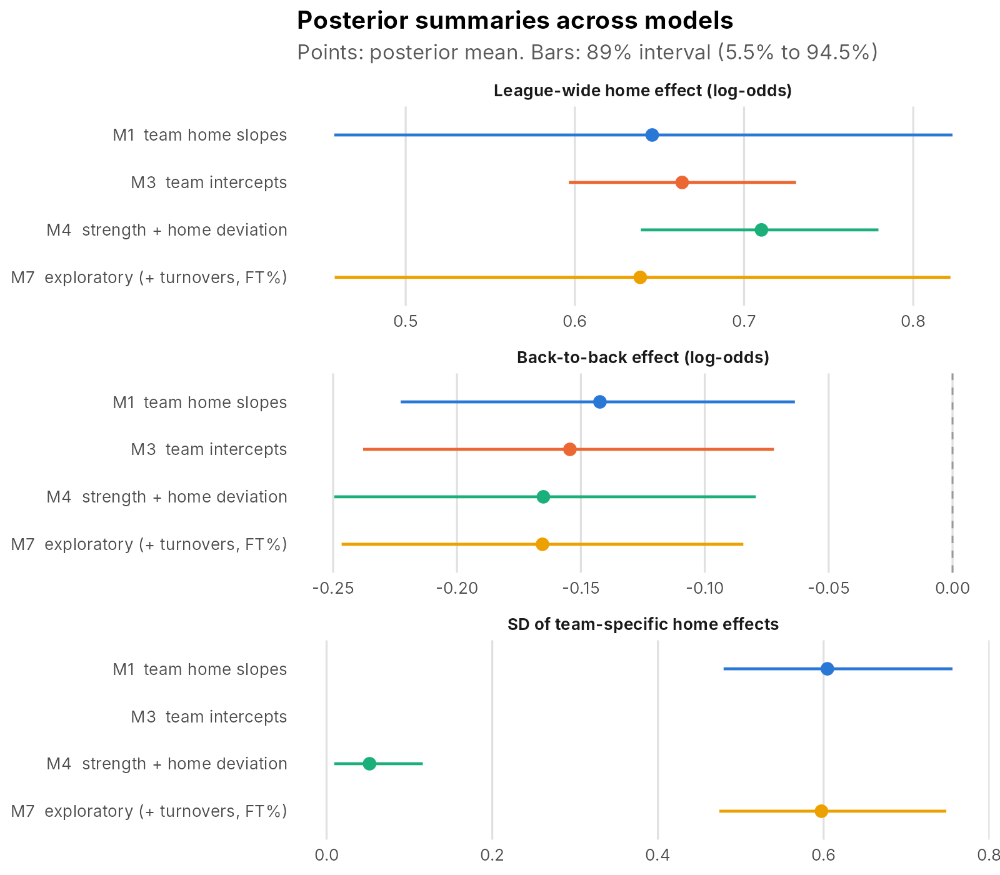
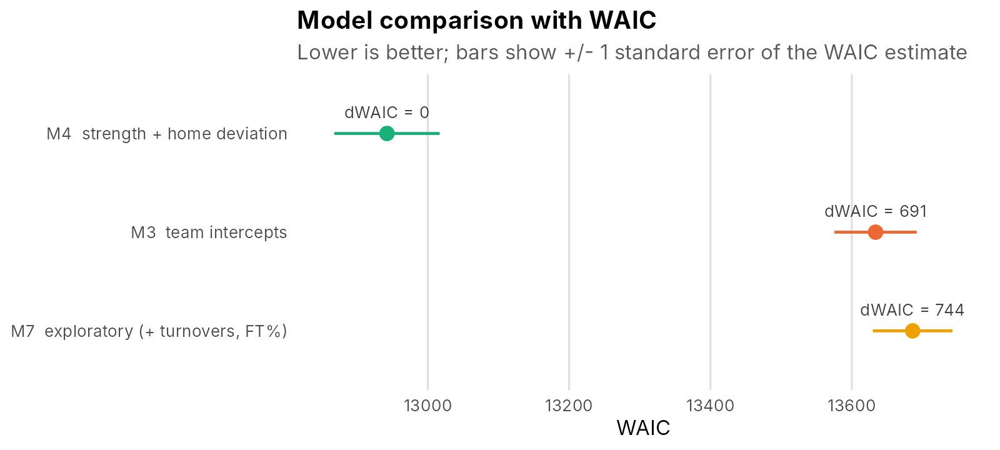

# Do NBA teams differ in their home-court advantage? A Bayesian hierarchical analysis

Final group project for the Bayesian Analysis course at Grinnell College (Spring 2026), by Albert, Sean, and Kevin (Kaijian Zheng).

We ask whether the size of the home-court advantage (HCA) differs across NBA teams, or whether it is essentially the same everywhere once we account for how good each team is. We model every regular-season game from 2014-15 to 2017-18 (4,920 games, 30 teams) with Bayesian logistic regressions fit in Stan through the R package `rethinking`.

> **Status of the results.** The tables and figures in `results/` and `figures/` come from the original run in the course project, which had a data-preparation bug (all Clippers games were duplicated; see [Known issue in the original run](#known-issue-in-the-original-run)). The scripts in `R/` are fixed. Re-running `R/02_fit_models.R` and `R/03_model_comparison.R` regenerates the results on the corrected 9,840 rows.



## Main results (original run)

| Question | Answer from the models |
|---|---|
| How large is the league-wide home effect? | Model 4: 0.71 log-odds (89% interval 0.64 to 0.78). For two evenly matched, rested teams this is about a 60% win probability at home against 42% away (plugging in posterior means). Home teams won 58.2% of games in the data. |
| Does playing a back-to-back matter? | Yes, in the same direction in all four models. Model 4: -0.17 log-odds (89% interval -0.25 to -0.08). |
| Do teams differ in their HCA? | Without a team-strength term (Model 1) the spread of team-specific home effects is large: SD 0.60 (0.48 to 0.76). Once team and opponent strength are in the model (Model 4) it shrinks to 0.05 (0.01 to 0.12). This is consistent with the Model 1 differences mostly reflecting how good each team is, but it is an association in four seasons of data, not proof that no team has a special home edge. |
| Which model predicts best? | Model 4 (team strength minus opponent strength, plus a team-specific home deviation) has the lowest WAIC: 12,942 versus 13,634 for Model 3 and 13,686 for Model 7. |
| Do turnovers and free-throw shooting matter? | In the exploratory Model 7, per standard deviation: turnovers -0.23 (-0.27 to -0.20), free-throw % +0.23 (0.20 to 0.26). These are in-game outcomes that may partly *mediate* the home effect, so they are not treated as causal controls. |



Sampler diagnostics: R-hat is at most 1.004 for every parameter in Models 1, 3 and 7. In Model 4 the worst case is `sigma_home` (R-hat 1.021, bulk ESS about 160), so its interval is the least precisely estimated number above.

## Models

Each row of the data is one team in one game. `win` is 1 if that team won. All models use `win ~ Bernoulli(p)` with weakly informative priors on the log-odds scale (`Normal(0, 1.5)` for intercepts, `Normal(0, 1)` for slopes, `Exponential(1)` for standard deviations). Notation follows `docs/variable_glossary.pdf`.

| Model | Linear predictor for logit(p) | Idea |
|---|---|---|
| M1 | `a + (b_home + u_team[team]) * home + b_b2b * b2b` | Team-specific home slopes, no team strength |
| M3 | `a_team[team] + b_home * home + b_b2b * b2b` | Team intercepts, one league-wide home effect |
| M4 | `a + strength[team] - strength[opponent] + (b_home + u_home[team]) * home + b_b2b * b2b` | Team and opponent strength, plus team-specific home deviations |
| M7 | M1 `+ b_tov * tov_z + b_ft * ft_pct_z` | Exploratory: adds turnovers and free-throw % (standardised) |

Team-level terms (`u_team`, `u_home`, `strength`, `a_team`) are partially pooled: they are drawn from a normal distribution whose standard deviation is estimated from the data. Each model runs 4 chains of 4,000 iterations (warmup 1,500, except M4 with 2,000 and M7 with 1,000). The model code is in `R/02_fit_models.R`. The exact specification and the plan we started from are in `docs/project_proposal.pdf`.

## Repository layout

```
R/
  00_prepare_model_data.R   builds the model data (team index, standardised predictors)
  01_build_dataset.R        raw Kaggle game table -> data/team_game_data.csv
  02_fit_models.R           fits M1, M3, M4, M7 with rethinking::ulam, writes results/*_summary.csv
  03_model_comparison.R     WAIC for the fitted models -> results/waic_table.csv
  04_figures.R              figures/*.png from the result tables
data/
  team_game_data.csv        one row per team per game, 9,840 rows (4 seasons x 2,460)
results/                    posterior summaries (mean, sd, 89% interval, R-hat, ESS) and WAIC table
figures/                    plots used in this README
docs/
  project_proposal.pdf      project idea, model and analysis plan
  variable_glossary.pdf     notation and variable definitions
notebooks/
  final_project_original.Rmd  the original R Markdown file the scripts above were refactored from
```

## Reproducing the analysis

Requirements: R 4.x, the CRAN packages `dplyr`, `readr`, `tidyr`, `tibble`, `lubridate`, `ggplot2`, and the `rethinking` package with Stan (CmdStan or RStan) for the model fits. See the [rethinking installation instructions](https://github.com/rmcelreath/rethinking). Run everything from the repository root.

```bash
# Optional: rebuild the dataset from the raw Kaggle table (see "Data").
# Skip this step to use the committed data/team_game_data.csv.
Rscript R/01_build_dataset.R data/raw/game.csv

# Fit the models (slow; the fitted objects are 1 to 2.5 GB each and are git-ignored)
Rscript R/02_fit_models.R          # or e.g.  Rscript R/02_fit_models.R m4

# Compare models, then draw figures
Rscript R/03_model_comparison.R
Rscript R/04_figures.R
```

`R/00_prepare_model_data.R` can be run on its own to inspect the data passed to Stan; it gives 9,840 rows and 30 teams. `R/01_build_dataset.R` was checked by rebuilding the dataset from a game table reconstructed from `data/team_game_data.csv` (the output was identical to the committed file), not against the original Kaggle download. The Stan fits were not re-run after the refactor, so `R/02_fit_models.R` and `R/03_model_comparison.R` have been syntax-checked only.

## Data

The raw data are the NBA game logs in the Kaggle dataset ["Basketball Data" by Wyatt Walsh](https://www.kaggle.com/datasets/wyattowalsh/basketball), which collects statistics from NBA.com. The raw table (`game.csv`) is not included here; download it from Kaggle and place it at `data/raw/game.csv` to run `R/01_build_dataset.R`. Check the dataset's terms on Kaggle and NBA.com before reusing the data.

`data/team_game_data.csv` is our processed version. Each game becomes two rows, one from each team's point of view.

| Column | Meaning |
|---|---|
| `game_id`, `game_date`, `actual_season` | Game identifier, date, and season (`14_15` to `17_18`) |
| `season_type` | Always `Regular Season` |
| `team_id`, `team_abbreviation`, `team_name` | The team the row describes |
| `opponent_id`, `opponent_abbreviation`, `opponent_name` | The opponent |
| `home` | 1 if the team played at home, 0 if away |
| `win` | 1 if the team won |
| `team_score`, `opp_score` | Final points for the team and the opponent |
| `fgm`, `fga`, `fg_pct`, `fg3m`, `fg3a`, `fg3_pct`, `ftm`, `fta`, `ft_pct`, `oreb`, `dreb`, `reb`, `ast`, `stl`, `blk`, `tov`, `pf` | Team box-score totals and percentages for the game |
| `plus_minus` | Point differential for the team |
| `days_since_last` | Days since the team's previous game in the same season (`NA` for the first game) |
| `b2b` | 1 if the team also played the previous day |

Seasons are assigned by the dates of the first and last regular-season games (for example 2017-10-17 to 2018-04-11 for `17_18`). The 2018-19 window exists in the code but this dataset has no games from it. Only `win`, `home`, `b2b`, `tov`, `ft_pct` and the team and opponent identifiers enter the models.

## Known issue in the original run

The Clippers are listed as "Los Angeles Clippers" in 2014-15 and "LA Clippers" from 2015-16 on, with the same `team_id`. The original notebook built its team lookup by taking distinct (id, abbreviation, name) combinations, which gave 31 teams instead of 30, and then joined it back by `team_id`. That duplicated every game involving the Clippers (as team or as opponent): 656 extra rows, so the models were fit on 10,496 rows instead of 9,840, and the Clippers were split across two team indices. The WAIC table in the original results was also normalised by 10,496.

`R/00_prepare_model_data.R` now builds the lookup with one row per `team_id` and stops with an error if the row count changes or the number of teams is not 30. The committed `results/` and `figures/` have not been regenerated yet, so the numbers above should be read as approximate until the models are re-run.

## Limitations

- Four seasons of regular-season games only; no playoffs, and nothing after 2017-18.
- Team strength is a single latent value per team across all four seasons, so roster changes and improving or declining teams are not modelled.
- Back-to-back is the only schedule variable. Travel distance, altitude, attendance and arena effects, which the proposal lists as possible sources of HCA, are not included.
- Turnovers and free-throw percentage are measured during the game, so Model 7 describes association, not the effect of changing them.
- Model 1 was not scored with WAIC in the original run (its fit object was not saved), so the committed WAIC table covers Models 3, 4 and 7.

## Credits

Group project by Albert, Sean, and Kevin (Kaijian Zheng). The statistical approach follows McElreath, *Statistical Rethinking*, and uses his `rethinking` package.
